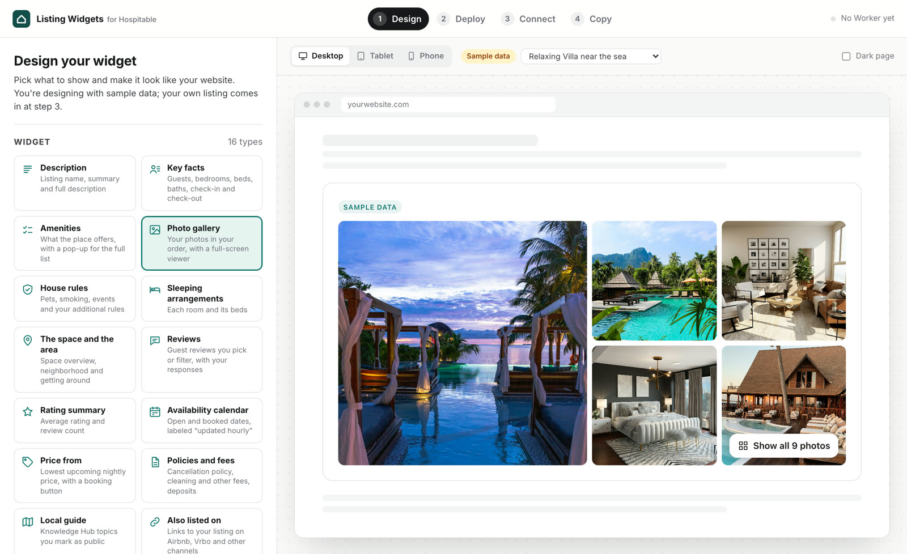

# Hospitable Listing Widgets builder

The website where you design widgets that show your [Hospitable](https://hospitable.com) listings on your own website, then copy them into Wix, Squarespace, WordPress, Webflow or any other site. Open it at [hospitable-widget.adhityoagam.com](https://hospitable-widget.adhityoagam.com/).

The widgets it makes run on the free, open-source [Hospitable Listing Widgets](https://github.com/agmadt/hospitable-widgets) kit. That project's README explains what it costs, how fresh the data is and what stays private.

## What you do in it

The builder takes you through four steps, shown at the top of the page.

1. Design. Pick one of the 16 widgets, such as a photo gallery, amenities, reviews or an availability calendar. Choose its colors, fonts and layout, or start from one of six ready-made styles. The font can follow your website's own font, or be any font from Google Fonts. The preview shows the widget on a desktop, a tablet or a phone, and on a light or a dark page. Until you connect your own listings, you design with sample data. If you know HTML, you can also edit the widget's code directly.
2. Deploy. The builder shows you how to create an access token in Hospitable, then sends you to Cloudflare's website. There you paste the token and set up your Worker: a small program in your own free Cloudflare account that keeps your listing data up to date.
3. Connect. Open your Worker's address and the builder connects to it. Pick one of your properties, and the preview switches to your real listing.
4. Copy. Copy the snippet, two lines of code, and paste it into your website. The builder shows where it goes on Wix, Squarespace, WordPress, Webflow and other sites, suggests a height for Wix embeds, and can open the widget on a test page first.

To change a widget later, come back, adjust it and copy a new snippet to replace the old one. Changes you make to your listing in Hospitable reach your website on their own.

## Your token and your data

- The builder has no field for your Hospitable token. You paste the token on Cloudflare's own website, at `dash.cloudflare.com`.
- The builder has no server of its own. It runs in your browser, and to show your real listing it reads the same public information that your website will show.
- Your design is saved in your browser, on this device only. Another browser or computer starts with a fresh design, and clearing your browser's data for the site removes it.
- The builder has no tracking or analytics. To work, it loads its fonts from Google Fonts, the widget code from jsDelivr and the sample photos from Unsplash.

## If something doesn't work

The kit's README has a table of common problems and their fixes: [If something goes wrong](https://github.com/agmadt/hospitable-widgets#if-something-goes-wrong). It covers, for example, a gallery that only shows the cover photo, a Worker address that won't open, and a token that Hospitable rejects.

---

Working on the builder itself? Read the [developer guide](docs/developers.md).
